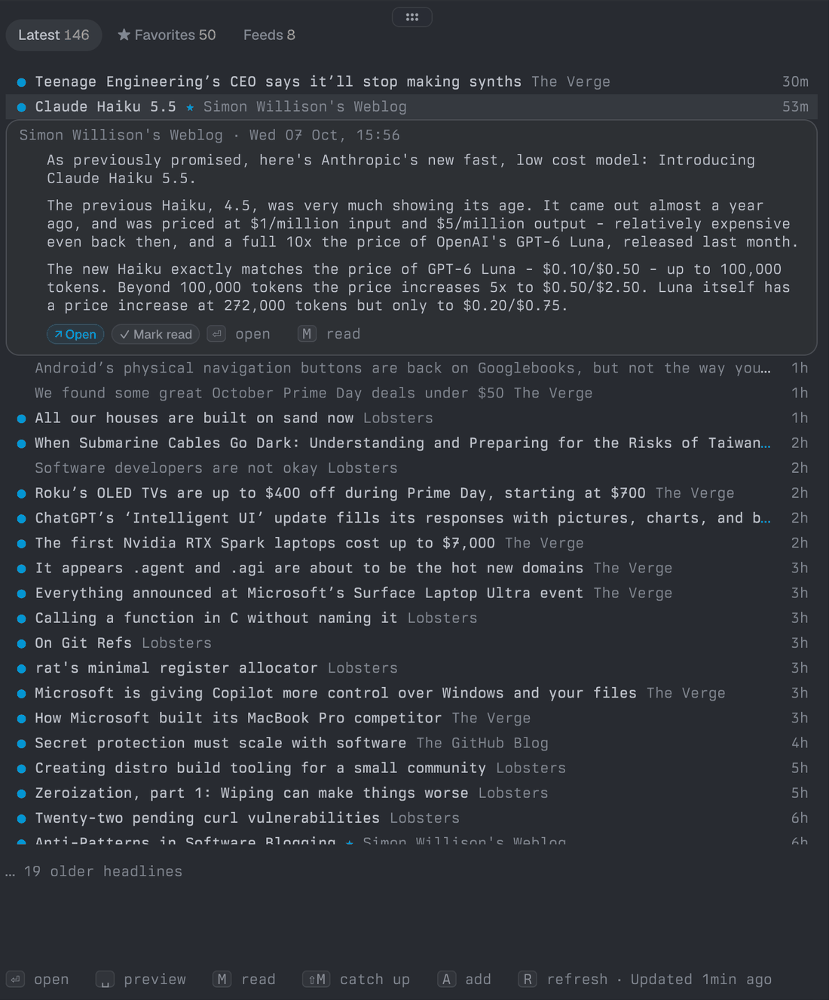
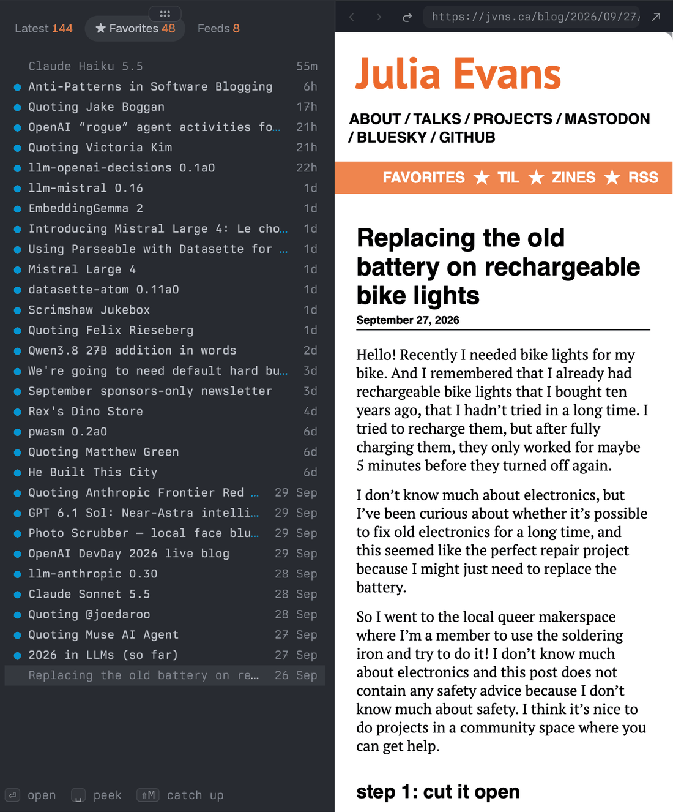
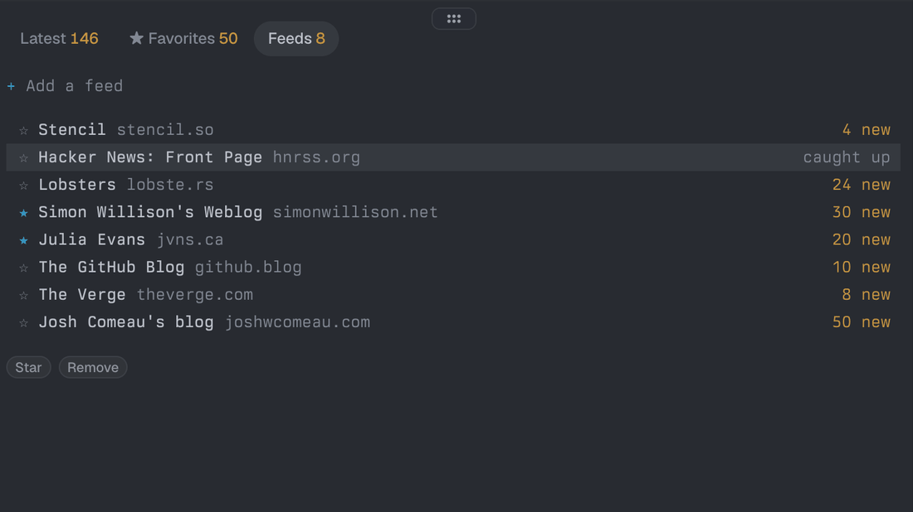

# Tern RSS _(tern-rss)_

RSS and Atom feeds in a Tern block: headlines, previews, a docked reader, favorites and catch-up.



Follow feeds without leaving the terminal. The RSS block shows headlines first and opens a preview when you ask. Articles open in one pane docked beside the list: a native reader block that draws their text and images in place, or Tern's browser if you prefer (`b`). Starred feeds show a toast when they post.

The palette offers **Open RSS** (a block beside the focused pane) and **Open RSS in a new tab** (a block alone in a tab, full width). The reader block has no palette entry: the RSS block opens it.

## Contents

- [Install](#install)
- [Usage](#usage)
- [Settings](#settings)
- [Privacy](#privacy)
- [Requirements](#requirements)
- [Uninstall](#uninstall)
- [Develop](#develop)
- [Contributing](#contributing)
- [License](#license)

## Install

```sh
tern plugin install github.com/bmanturner/tern-rss
```

- Update: run the same command with `--force`.
- From a local clone: `tern plugin install ./tern-rss`.

Then open the palette and run `New RSS block` or `Open RSS`.

## Usage

On first run the block offers four starter feeds. Press `a`, or paste any site or feed URL, to follow your own.

### Tabs

| Tab | Shows |
| --- | --- |
| Latest | Headlines from every feed. Posts that arrived since you last caught up come first, with `●` and a strong title. A "caught up" line separates them from older posts. Read posts dim in place, so nothing moves under the cursor. The filter (`f`) narrows this tab. |
| ★ Favorites | Headlines from starred feeds only. The filter doesn't apply here. |
| Feeds | Your subscriptions with new-post counts and refresh errors, plus sites Carly is still searching. Star, catch up, group, edit, remove and add feeds here; grouped feeds sit under a header row. |



### Keys

| Key | Does |
| --- | --- |
| `1` `2` `3`, `tab` / `shift+tab` | Switch tabs |
| `j` `k`, arrows, `g` `G`, `page_up` `page_down` | Move |
| `space` (`→` / `←` to show / hide) | Toggle the preview under the selected headline |
| `enter` or `o` | Open the article beside the list (marks it read): in the native reader by default, which draws its text, headings, lists, quotes, code and images in place (page furniture such as navigation, sidebars, footers and forms is left out), or in Tern's browser. One pane reads every article; a page the reader can't read (an error, too little text, or an encoding other than UTF-8 or Latin-1) opens in the browser in its place |
| `b` | Switch where articles open: the native reader or Tern's browser (saved, shared by every RSS block) |
| `m` | Mark one post read / unread |
| `shift+r` | Mark the posts this tab shows read, or unread when they all already are |
| `shift+m` | Catch up: everything in this tab (on Feeds, the selected feed) stops being new |
| `u` | Undo the last catch-up (until you switch tabs) |
| `s` (Feeds) | Star a feed: its new posts show a toast |
| `d` twice (Feeds) | Remove a feed (removing a group's last feed also clears that group from the filter) |
| `a`, or paste a URL | Add a feed |
| `r` | Refresh every feed now |
| `c` | Ask Carly to find a feed after one wasn't found; `esc` dismisses |
| `f` (Latest) | Edit the filter: read state, groups, then ordered rules |
| `t` (Feeds) | Set the selected feed's group (`t`, since `g` jumps to the top) |
| `e` (Feeds) | Edit the selected feed: its title and its URL, on one line (`Title https://example.com/feed`, or `Title example.com/feed`). Leave either out to keep it; a title only counts as yours when you change it. A new URL must itself be a feed (no page discovery): it is fetched before it replaces the old one, is refused when you already follow it, and replaces the feed's posts. The field stays open while it is checked; a refusal shows the reason under the field and keeps what you typed, and a title typed with a refused URL is not saved either. If the feed changed while the field was open (another block gave it a new URL), the field asks you to open it again |

### Counts and catch-up

Counts mean "new since you last caught up", not "everything unread". They reset when you catch up instead of growing. The pane title counts only new posts from starred feeds.



### Finding a feed

A pasted feed URL is followed directly. For a web page, the block tries candidates in this order and follows the first one that parses:

1. The page's `<link rel="alternate">` feeds.
2. Links on the page that look like feeds.
3. Known platforms' feed URLs: YouTube channels and playlists, subreddits, GitHub repos and users, Medium, Bluesky and Mastodon-style `@profiles`.
4. `/feed`, `/rss`, `/feed.xml`, `/rss.xml`, `/atom.xml` and `/index.xml`, at the site root and under the page's path.

Unreachable hosts and bad addresses show their error under the add field. When the host answered but no candidate parsed, the block offers "Ask Carly to find it" (press `c` or click it; `esc` dismisses). Only then does Carly open with the question, look harder, and answer through the plugin's `found` / `not_found` exports. The block then follows the feed and shows a toast, or shows Carly's reason in a toast. A search Carly doesn't finish in 10 minutes also ends with a toast. Starter feeds never go to Carly.

> [!NOTE]
> Asking Carly needs the window and the RSS block to share the plugin data directory. When the RSS block runs on a remote host, Carly isn't asked, and the search ends after 10 minutes with the "Carly didn't finish the search" toast.

### Groups and the filter

A feed's group is one line of text (up to 60 characters); a feed with none is ungrouped. On Feeds, `t` opens a one-line field with the selected feed's group in it: Enter assigns it, an empty line leaves the group, and a name that isn't taken yet makes a new group. Once any feed is grouped, the Feeds list draws a header row per group and nests that group's feeds under it, and `j` / `k` / `g` / `G` move through the feeds in that drawn order. Header rows aren't selectable, so selection stays on feed ids. Groups come from the feeds themselves: remove the last feed of a group and the group goes with it, along with its check or exclusion in the filter.

The filter narrows Latest. `f` opens it, and `esc` or `f` closes it. It is a read-state gate, a group gate and an ordered list of rules. A status line above the headlines always shows what it is doing, with the Latest tab counting only the posts the filter shows:

```text
Filter 1 group in · 1 rule · 4 posts hidden   f edit
```

- **Read state.** The first row steps through every post, unread only, and read only with `space` or `x`. The filter starts at **unread only**, so a reader that already knows what you have read buries what you have not. This is a hard gate: it decides before the groups and the rules do, so "unread only" means unread.
- **Groups.** One row per group, plus an "Every group" row. `space` checks the group under the cursor; the checked groups are a whitelist, and with nothing checked every group is in. `x` excludes a group, which always loses, even to a `keep` rule; a group is never both checked and excluded. `space` on "Every group" unchecks every group, which is the same as "all".
- **Rules.** Rows are numbered in the order they are read, each shown as `<n> /pattern/flags  <scope>`. `a` adds a rule (the field opens prefilled with the group under the cursor, when there is one), `d` deletes the selected rule, and `K` / `J` move it up or down in that order. `j` / `k` and the arrows move the cursor, and `1` `2` `3`, `tab` and `r` work as they do outside the panel.

A rule is one line, and the common case is just a pattern:

```text
/sponsor/                  hide matching posts, everywhere
@frontend /sponsor/        ... in one group only
#Rust Weekly /ads?/i       ... in one feed only (spaces in a name are fine)
@"News / Tech" /ads?/      quote a name that holds " /", ends in "keep" or "drop", or is one of them
@frontend keep /rust/      show a matching post again (an exception to a drop)
```

`drop` only has to be written to be explicit; leaving it out means drop. A scope is `@group` or `#feed`; a group is named in any letter case, and a feed by its title, its URL, its id, or its host. The pattern starts at the first `/` that begins a word, so a name may hold a slash (`@News/Tech /x/`), and it runs to the last `/` on the line, so a slash inside the pattern needs no escaping.

The pattern is a real regular expression, with `i` (caseless, ASCII letters only), `m` (multiline), `s` (dotall) and `x` (spaced) flags after the closing slash; inline flags such as `(?i)` are refused with a pointer to those. A pattern that does not compile is refused in the field, with the engine's reason. Patterns see the post's text as it is: the title, a space, then the feed's preview, so `^` is the start of the title and `$` the end of the preview when there is one.

#### What to write

Every line below is a whole rule, checked against the engine that ships in the package:

| Want | Write | Notes |
| --- | --- | --- |
| Hide sponsored posts anywhere | `/sponsor/i` | `i` covers `Sponsor`, `SPONSOR`, `sponsored` |
| Hide either of two words | `/赞助|推广/` | alternation, no group needed |
| Hide Chinese and English spellings | `/(?:sponsor|广告)/i` | `(?:…)` groups the alternation |
| Hide anything with a price | `/\d{3,}元/` | `\d` digit, `{3,}` three or more |
| Hide posts that start with a marker | `/^(▲|Show HN)/` | `^` anchors to the start of the title |
| Hide posts that end with a word | `/周刊$/` | `$` is the end of the preview when the feed gives one, else of the title |
| Hide a word, but not inside a longer one | `/(^| )word( |$)/` | `\b` is not available; see below |
| Hide one feed's ads | `#Rust Weekly /ads?/i` | feed by title; spaces need no quoting |
| Hide a site's promos | `#lobste.rs /promo/` | feed by host also works |
| Hide a whole group's off-topic posts | `@news /^\[OT\]/` | group scope |
| Hide everything except one topic | `keep /rust|zig/i` then `/./` | first match wins, so the exception goes above |
| Hide pricing symbols anywhere | `/[$€£]\d+/` | a class covers several symbols at once |
| Hide post series by number | `/连载\s?\d+/` | `\s` is whitespace, `?` makes it optional |
| Ignore case **and** allow spaces for readability | `/s p o n s o r/ix` | `x` drops whitespace from the pattern |
| Match a literal slash | `/事件\/回顾/` | the pattern runs to the last `/`, so `/事件/回顾/` works too |

The two rules that keep one topic out of an otherwise noisy feed, in the order they must appear:

```text
keep /(rust|zig|lua)/i
/./
```

Shapes the engine cannot run, all refused under the field rather than failing quietly:

- `\b` and `\B` raise at match time in the vendored engine, so they are rejected when the rule is parsed. Write the boundaries by hand: `/(^| )word( |$)/`.
- A pattern has to be inside `/…/`. A bare `sponsor` is refused with "A rule needs a /pattern/".
- A pattern that can't finish: a repeated group that can match nothing (`(a*)*b`), or nested repeats that backtrack without end (`(\w+\s?)+$`, `(a|aa)+$`). A leading `.*`, `.+`, `(.*)` or single repeated class (`[^。]*`) is dropped before compiling, since a rule already matches anywhere, so `/.*sponsor.*/` and `/[^。]*赞助/` are fine.
- A pattern the engine raises on even though it compiles (some repeated lookarounds and recursions), with the engine's reason.

Luau ships no regular expressions, and Tern has no dependency manager, so the engine is vendored: `lib/regexp.luau` is [Roblox's luau-regexp](https://github.com/Roblox/luau-regexp) (MIT, from Blockzez), carried in the package and licensed beside it in `lib/regexp.LICENSE`. It is in-process Luau, so the plugin still runs **no programs**. The vendored copy counts its steps and gives up past a limit, so no rule can stall the block: a pattern that gives up on the samples is refused when it is added, one that gives up on a real post is skipped from then on and marked "skipped: too slow on a post" in the panel, and one the engine raises on is marked "not applied" with its reason. Matching runs once per post and rule, not on every redraw; a large store is filtered a slice at a time, and the status line says "filtering N more posts" until it is done.

Rules are read in order and the first match decides: `drop` hides the post, `keep` shows it. When no rule matches, the group gate decides. `/./` hides everything, so `keep` rules above it are a whitelist. Catch-up on Latest covers the feeds the group gate keeps; posts a rule hides are caught up with their feed.

The filter belongs to Latest only, so Favorites shows every starred feed as is. Like the feed list, it is shared by every RSS block in this host.

### Refresh and toasts

- Feeds refresh every 15 minutes while any RSS block is open. A background tab is fine.
- The first fetch of a feed never shows a toast.
- Feeds (with their catch-up times), read state (kept 180 days), per-feed caches and Carly hand-off files live in `rss/` in the plugin data directory.

> [!NOTE]
> Favorite and Carly toasts show only while an RSS block is open somewhere in the session.

## Settings

The refresh interval is the kv key `config/block/rss/refresh_minutes` (default 15, at least 5). To change it, edit `~/Library/Application Support/Tern/plugin-data/tern-rss/kv.json`:

```json
{"config/block/rss/refresh_minutes": 30}
```

The value is re-read before each refresh and shared by all RSS blocks.

Where articles open is the kv key `config/block/rss/reader`: `"native"` (the default, the reader block) or `"browser"` (Tern's browser). `b` in the RSS block flips it; the next article you open follows it.

```json
{"config/block/rss/reader": "browser"}
```

The Latest filter is edited in the block (`f` on Latest) and lives in `rss/filters.json` in the plugin data directory, where it is hand-editable:

```json
{"version":1,"read":"unread","groups":{"tech":true},"excluded":{},"rules":["#Rust Weekly keep /./","/sponsor/i"]}
```

`read` is `all`, `unread` or `read`, `groups` holds the checked groups, `excluded` the excluded ones, and `rules` the rule lines in the order they are read. A file that doesn't decode is kept as `filters.json.bad` and the filter starts over from its defaults (unread only, no groups, no rules). A rule line that doesn't parse stays where it is and is written back untouched: the panel shows it with a ⚠ and the reason, it does nothing until you fix it by hand, and `d` deletes it. Groups no feed carries any more are dropped from the file when it loads. When `feeds.json` failed to load (it is kept as `feeds.json.bad`), the saved group checks and exclusions are set aside instead: they don't apply, so feeds you add meanwhile stay visible, and they stay in the file, so restoring `feeds.json.bad` brings them back. Deleting `feeds.json.bad` ends that at the next start. The filter is shared by every RSS block in this host, like the feed list.

## Privacy

- **Network:** the plugin fetches the feed URLs you follow. While you add a site, it also fetches candidate feed URLs on that site's host and links the page itself points to. Candidates whose address is written as loopback or private-network (`localhost`, `127.0.0.1`, `192.168.…`) are skipped unless the URL you pasted is itself local; this checks the address as written, so a public name that resolves to, or redirects to, a private address still gets through. Articles you open are fetched and drawn by the reader block, with the images they show (images on such addresses only when the article is on one too); a page it cannot read opens in Tern's browser instead, and with the `browser` setting every article does.
- **Carly:** asked only when you choose "Ask Carly to find it".
- **Nothing else:** no telemetry, no accounts, no sync.

> [!WARNING]
> When you ask Carly, the plugin sends that site to Tern's assistant (`cx:ask_carly`), which uses a model turn and reads the third-party site. Per Tern, Carly has full local access. The plugin's prompt tells Carly to treat the site's content as untrusted data and to only fetch pages and call the plugin's exports, but a prompt can't enforce that. Only ask about sites you trust.

### What it runs and writes

- **Network:** each feed URL with `tern.fetch`, every refresh interval while an RSS block is open. Requests are conditional (`If-None-Match` / `If-Modified-Since`), at most 4 at a time, with a 20 s timeout; bodies over 4 MB are rejected. Adding a site also fetches its feed candidates, at most 4 at a time with a 10 s timeout each. The reader fetches the article page (it reads the first 1.5 MB) and up to 12 of its `http(s)` images with `tern.fetch`'s defaults (30 s); an image is shown only when it is `image/*` and at most 4 MiB.
- **Programs:** none.
- **Writes:** in the plugin data directory, `rss/feeds.json` (each feed and its group), `rss/read.json`, `rss/filters.json`, `rss/cache/<feed>.json`, `reader-<rss pane>.json` (the last article clicked in that RSS pane, its click number and time, which the reader beside it follows; a few bytes, overwritten by the next click) and, only after you ask Carly, `rss/carly/<id>.{request,answer,asked,result}.json`; `kv.json` when config is set, when `b` is pressed, and for the `articles` key (which pane beside each RSS pane is its article pane). Nothing in the package folder.
- **Reads:** `plugin.toml`, the `blocks/` listing, and the files above.
- **Logs:** warn lines prefixed `tern-rss`.

## Requirements

- Developed and tested on Tern 0.6.1, desktop.
- Uses Carly exports and `ask_carly` (for the optional, ask-first feed search), and Tern's browser API for the `browser` setting and for pages the native reader cannot read.
- The plugin's host half runs where the panes run. To use the RSS block in a pane on a remote host, install the plugin on that host too, following Tern's remote-host rules. The reader, its click file and the `b` setting live on that host with the RSS block, so articles open the same way there.

## Uninstall

```sh
tern plugin remove tern-rss
```

Your feeds and read state stay in `~/Library/Application Support/Tern/plugin-data/tern-rss/` (macOS). Delete that folder to reset.

## Develop

```sh
git clone https://github.com/bmanturner/tern-rss
cd tern-rss
tern plugin link .     # once; Tern loads the plugin from this folder
tern plugin types .    # writes tern.d.luau (git-ignored) for luau-lsp
tern plugin reload     # explicit reload (saving a file reloads within ~300 ms)
tern plugin list       # status, blocks and load errors
```

Logs: `~/Library/Logs/Tern/tern-daemon.log` (host half: the block, store, polling) and `~/Library/Logs/Tern/tern.log` (window half). Tern drops `tern.log.info` by default, so use `tern.log.warn` while debugging.

### Files

```text
plugin.toml            manifest
host.luau              block registry (host half)
window.luau            palette commands, article routes (reader / browser), Carly route (window half)
blocks/rss.luau        the RSS block; returns its BlockDef
blocks/reader.luau     the native reader block: text and images in document order (host half)
lib/manifest.luau      reads [[blocks]] id/title/palette from plugin.toml (both halves)
lib/config.luau        typed per-block config over tern.kv; the rss settings (both halves)
lib/cards.luau         error card + props helper                       (both halves)
lib/poll.luau          pane liveness check                             (host only: tern.pane)
lib/target.luau        the RSS block's clicks, for the reader beside it (host only)
lib/fmt.luau           times, ages, counts, durations, clipping, trim  (both halves)
lib/url.luau           percent-encoding, URL normalize/host/resolve,
                       private-address check                           (both halves)
lib/feed.luau          RSS/Atom/RDF parser, feed candidates, dates,
                       article extraction for the reader               (both halves, pure)
lib/filter.luau        the Latest filter: rules, parser, match test     (both halves, pure)
lib/regexp.luau        vendored regex engine (MIT; see its LICENSE)     (both halves, pure)
lib/carly.luau         find-a-feed hand-off files between the halves   (both halves)
lib/store.luau         feeds, read/catch-up state, caches, polling,
                       toasts, adding with probing, Carly searches     (host only)
docs/                  README screenshots
PRODUCT.md             product brief (users, purpose, principles)
LICENSE                MIT
```

## Contributing

Questions, bug reports and pull requests are welcome in [issues](https://github.com/bmanturner/tern-rss/issues) and [pull requests](https://github.com/bmanturner/tern-rss/pulls). Set up with the [Develop](#develop) steps. Keep every file `--!strict`, and type-check every file (not just the entry files) with luau-lsp against the `tern.d.luau` that `tern plugin types .` writes, for example `luau-lsp analyze --definitions=@tern=tern.d.luau host.luau window.luau blocks/*.luau lib/*.luau`. `lib/regexp.luau` is the one exception: it is vendored third-party code, so leave it as it came, license and all, apart from the three patches its header lists (the flag names, the step limit, and the repeated empty backreference).

## License

[MIT](LICENSE) © 2026 Brendan Turner
